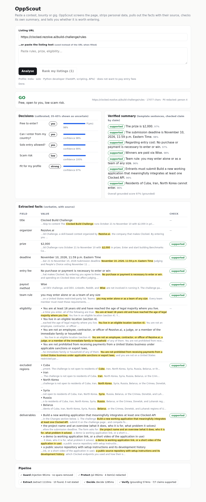

# OppScout

**Is this contest, bounty or gig worth my time — and is it even safe to read?**

OppScout takes a contest / bounty / gig URL (or pasted text), fetches the page, and runs it through six
[Clocked](https://clocked.rezolve.ai) endpoints to give you: a prompt-injection screen, a personal-data-free
copy of the page, the key facts with their exact source spans, a summary checked claim-by-claim against the
source, calibrated yes/no answers for *your* profile (default: India · solo · Python developer), and a
ranking across several listings.

Built for the Clocked Build Challenge (Oct 21 – Nov 10, 2026).

## Why

Opportunity pages are long, inconsistent and sometimes hostile. People in India miss out because the
"who can enter" line is buried in section 4; others lose money to "entry fee" scams. And when you let an AI
read these pages for you, the page itself becomes an attack surface. OppScout treats every page as
untrusted, never invents a value, and says out loud when it is unsure.



## Setup

```bash
git clone https://github.com/abidhussain19932-stack/oppscout && cd oppscout
python -m venv .venv && . .venv/bin/activate
pip install -r requirements.txt
cp .env.example .env            # put your key in CLOCKED_API_KEY
export CLOCKED_API_KEY=...      # or use your env manager
uvicorn app.main:app --reload   # open http://127.0.0.1:8000
pytest -q                       # mocked tests, no credits used
python scripts/run_samples.py   # one real run (≈11 API calls) -> samples/
```

Deploy: `render.yaml` defines a free Render web service
(`uvicorn app.main:app --host 0.0.0.0 --port $PORT`); set `CLOCKED_API_KEY` in the dashboard.

The client sends `Authorization: Bearer $CLOCKED_API_KEY` when the variable is set, a fresh
`Idempotency-Key` UUID per logical request (reused on retry), and `Content-Type: application/json`.

## How it works

```
URL ─► fetch + strip HTML (public hosts only, 18k chars)
     ─► Guard   /injection   (source="content")      ─► quarantine flagged spans
     ─► Protect /pii         (anonymize="replace")   ─► all later steps read redacted text
     ─► Extract /extract  ║  Decide /decide          (in parallel)
     ─► Verify  /grounding   on an LLM-free templated summary
     ─► verdict GO / CHECK / SKIP with reasons
many listings ─► Rerank /rerank (context = profile)
```

### Each endpoint and how its output changes the app

| Endpoint | Request | How the output changes behaviour |
|---|---|---|
| **Guard `/injection`** | page text, `source:"content"`, custom security context, `evidence:true` | If verdict ≠ benign and p ≥ 0.5, every `evidence` span is replaced with `[removed by Guard]` **before** any other endpoint reads the page, a red banner shows category/severity/probability, Decide is told an attack was removed, and the verdict can never be GO (capped at CHECK). If Guard fails, a warning says the page was not screened. |
| **Protect `/pii`** | quarantined text, kinds person/email/phone/address/bank_account, `anonymize:"replace"` | `anonymized_text` becomes the working text for Extract, Decide, Verify and Rerank, so names, phones and emails on the page are never shown, stored in samples, or sent onward. Counts appear in the header. If it fails, the raw text is used and the UI says so. |
| **Extract `/extract`** | 10 fields: title, organizer, prize, deadline, entry_fee, payout_method, team_rule, and lists eligibility / excluded_regions / deliverables (capped `max_items`) | Fills the facts table. Every value is shown with its highlighted source span (`start`/`end`) so you can see *where* it came from. `null` → "not stated" (never guessed). Confidence < 0.6 → "low confidence" tag. Found values feed the summary and the Rerank digest. |
| **Verify `/grounding`** | `documents:[redacted page]`, explicit `claims` = one template sentence per extracted fact | The summary is built **without an LLM** (string templates over Extract values), then each sentence is checked. Each claim gets supported / contradicted / not_stated with its probability, and that verdict is written back onto the matching fact as a "Check" badge. Unverified claims stay visible but flagged; if Verify fails they show as "unchecked". |
| **Decide `/decide`** | redacted page as `state`, profile in `instructions`, 5 questions: `free_to_enter` (noul), `country_eligible` (choice yes/no/not_stated), `solo_allowed` (choice), `scam_risk` (score low/med/high), `profile_fit` (score) | Drives the GO / CHECK / SKIP verdict: SKIP if your country is excluded or scam risk is high; CHECK if anything is uncertain/not stated, medium risk, poor fit or Guard fired; GO only when free, open to you and low risk. Probabilities and confidences are shown as bars. |
| **Rerank `/rerank`** | query "an opportunity this entrant can enter free, alone, and win with Python", `context` = profile, one document per analysed listing (facts digest + text head) | Orders your saved listings: `use` first, then `expand`, then `skip` (with the `reason`, e.g. `different_case` when a listing is for another country/role, or `unrelated`), each by `relevance_score`. If Rerank fails, your original order is kept and marked "unranked". |

## Uncertainty and failure handling

- **Uncertain probabilities:** a yes/no probability between 0.35 and 0.65 is shown as **uncertain**, not
  rounded into an answer. A choice/score whose confidence is below 0.6 is shown as `uncertain (leaning X?)`.
  Any uncertain decision pushes the verdict to CHECK with a reason ("Country eligibility is not established").
- **Missing values:** Extract `null` → "not stated" in grey; nothing is filled in. A fact that is not found
  produces no summary sentence, so Verify never checks an invented claim.
- **Failed requests:** each Clocked call returns an envelope (`ok`, `status`, `error`, `ms`) instead of
  raising. 408/409/425/429/5xx and timeouts are retried once with the **same** Idempotency-Key (so a retry
  is not charged twice); 4xx validation errors are not retried; 401 tells you to set `CLOCKED_API_KEY`.
  The pipeline keeps going with the best input it has, and the Pipeline strip shows ✓/✗, latency and the
  error for each step. If Decide fails the verdict is "unknown"; if Rerank fails the list is unranked.
- **Fetch problems:** only http(s) to public hosts (SSRF guard); pages with almost no text (JS-only) ask you
  to paste the text instead.
- **Known limitation (seen in the real run):** Extract returns one span per scalar. For the Clocked rules
  the payout method "Wise" is correct, but the highlighted span is the first mention of Wise, not the
  "paid through Wise" sentence. Verify still marks the claim supported because the page does support it.

## Real outputs (`samples/`)

Recorded 2 Nov 2026 against the live API (11 calls in total):

- `clocked_rules.analysis.json` — Clocked Build Challenge rules: Guard benign (0.8%), 4 person names
  redacted, 10/10 fields found (prize $2,000; deadline Nov 10 2026 11:59 p.m. ET; "No purchase or payment
  is necessary"; paid via Wise; solo or team; excluded: Cuba, Iran, North Korea, Syria, Russia, Belarus),
  7/7 claims supported (grounded 0.97), Decide: free 0.98, India eligible (conf 0.98), solo yes, scam low,
  fit strong → **GO**.
- `elevenlabs_thesearch.analysis.json` — ElevenLabs "Search for the World's Catchiest Ad": 1 phone number
  redacted, 6/10 fields (prize $100K; deadline 1 November 11:59pm PST; entry fee, payout, eligibility not
  stated on that page), 4/4 claims supported, fit **uncertain (partial?)** at confidence 0.35 → GO with
  "Skill fit is uncertain".
- `rank.json` — Rerank for the India/solo/Python profile: Clocked challenge `use` (0.99), ElevenLabs ad
  contest `skip · unrelated` (0.01).

Screenshots in `screenshots/` render these real outputs in the UI.

## Project layout

```
app/clocked.py    async Clocked client (auth, idempotency, retry, error envelope)
app/fetcher.py    URL fetch + HTML→text with SSRF guard
app/pipeline.py   Guard→Protect→Extract‖Decide→Verify, verdict logic, Rerank
app/main.py       FastAPI routes: /, /api/analyze, /api/rank, /api/profile, /api/health
app/static/       single-page UI (no build step)
tests/            pytest with httpx.MockTransport (no network, no credits)
scripts/          run_samples.py for a real end-to-end run
```

## License

MIT
